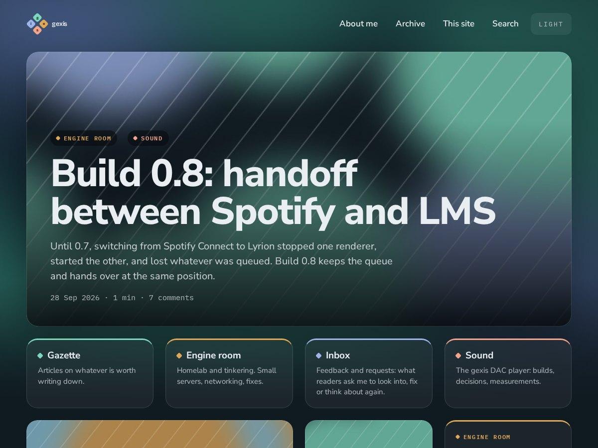

# gexis — a WordPress block theme

The theme for **gexis**, a personal site in four parts. The four letters of the
gexis mark are ordinary WordPress **tags**, not sections, and a post can carry
several:

| Letter | Tag slug | Tile | Covers |
|---|---|---|---|
| **g** | `gazette` | teal `#7ed6bc` | Articles on topics of interest |
| **e** | `engine-room` | amber `#e0a758` | Homelab and tech tinkering |
| **i** | `inbox` | periwinkle `#9fb4e8` | Feedback and requests from readers |
| **s** | `sound` | coral `#f2a48f` | The gexis DAC player |

The theme recognises those four slugs and gives each its colour, and lights its
letter of the mark on its archive. Any other tag renders neutral.

Built from the gexis design system: a blurred diagonal weave behind every page,
Nunito Sans for anything spoken and IBM Plex Mono for anything measured, dark
and light modes, native threaded comments with avatars, and a CV-style author
page.



## Version

**1.1.0**, 24 Oct 2026. What changed lately:

- **1.1.0** A new layout on every page: each opens with one large card (the
  post's picture with its title on it on the home page and on posts), and
  lists are cards on a grid. Posts get *On this page*; search marks the words
  searched for and counts the results by tag; the archive has a row per month.
  On an existing *This site* page, insert the pattern again to get the new
  side-by-side sections.
- **1.0.6** New screenshot, showing the current header.
- **1.0.5** Inbox is for reader feedback and requests. Its default
  description reads: *Feedback and requests: what readers ask me to look into,
  fix or think about again.* A description set in Posts → Tags still wins.
- **1.0.4** The home page's middle column is *Guides*: the pages that show a
  repository document, in their page order. It replaces *Most discussed*.
- **1.0.3** Pages take tags; a tag's archive lists its pages as *Documents*.
- **1.0.2** New block, *Repository document*.
- **1.0.1** Images in posts keep their own shape; *About me* in the header,
  *About* renamed *This site*.

The full list is the changelog in [readme.txt](readme.txt).

## Install

Clone this repository into `wp-content/themes/gexis`, or build a zip with
`dev/build-zip.sh` and upload `dist/gexis.zip` under **Appearance → Themes →
Add New → Upload Theme**. The folder must be named `gexis`.

Requires WordPress 6.6 and PHP 7.4 or later.

## Setting it up

1. **Tags.** Create the tags `gazette`, `engine-room`, `inbox` and `sound`
   (Posts → Tags). Their descriptions appear on the tag cards; if one is empty a
   default line is used.
2. **Featured images** drive the look: the picture headers, the tiles, and the
   blurred ground behind each page all come from them.
3. **About me** in the header opens the owner's author page, which is a CV.
   Fill in *Author page (gexis)* at the bottom of your user profile:
   location, lede, now, summary, links, work, skills, facts and a CV PDF URL.
   Repeating fields take one entry per line; the help text under each field
   shows the format. The owner is the first administrator unless you choose
   someone else in the Customizer.
4. **This site** is the page about the site itself. Create a page with the
   slug `site` and insert the *This site: the four tags* pattern (category
   *gexis*). An existing page with the slug `about` is used if there is no
   `site` page.
5. **Customizer → gexis.** Set the default background image (used behind pages
   with no image of their own), the owner, and, optionally, suggested
   searches.

The *Archive* link goes to the posts page if you have set one (Settings →
Reading); otherwise to `/archive/`, which the theme provides.

## How it is built

A block theme: templates, parts and patterns are block markup built from core
blocks, editable in the Site Editor. PHP is used only for what core blocks
cannot do, and each file under `inc/` opens by saying what that is.

```
theme.json             palette, type, spacing — the design tokens as presets
style.css              header + component styles
templates/  parts/     thin: header part, one pattern, footer part
patterns/              the markup of each template, translatable
blocks/                fifteen small server-rendered gexis/* blocks
inc/                   tags, query roles, bento grids, comments, routes, customizer, CV,
                       repository documents; inc/vendor/ holds Parsedown (MIT)
assets/css/ds/         the design system's token files, verbatim
assets/fonts/          self-hosted woff2, SIL OFL
dev/                   a throwaway Docker WordPress and a seed (not shipped)
```

The `gexis/*` blocks exist because core has no equivalent: the mark, the
blurred ground, the mono meta line (`28 Sep 2026 · 7 min · 12 comments`),
older and newer as picture cards, posts grouped by month, the post count, tag
chips and cards, the CV, the search states, *On this page*, the `Newer · 1 / 4 · Older` pager,
the colour-mode switch, and a document from the Gexis Player repository
(below). They have no build step: one plain script gives them all a
server-side preview and sidebar controls in the editor.

## Documents from the Gexis Player repository

The *Repository document* block (`gexis/repo-doc`) shows a Markdown file
from a public GitHub repository as a page, and keeps it current with no
manual step. Its settings: the file (`docs/FAQ.md`), the repository (default
`gcarstoiu/gexis-player`), the branch (default `main`), and whether to leave
out the document's own title, since the page has one.

- **Fetching.** The file comes from `raw.githubusercontent.com`, the only
  host the block can reach; repository, branch and path are checked first
  (a relative `.md` path, no `..`). The rendered page is cached for an hour.
  Each good fetch is also saved, so when GitHub does not answer the last copy
  is shown (its date in the line under it) and GitHub is asked again ten
  minutes later. With no copy yet, a short notice links to the file on GitHub.
- **Links.** A link to another `.md` file goes to the page on this site that
  shows that file, if there is one (any published page holding the block with
  that path), otherwise to the file on GitHub. Anchors are kept, and headings
  carry GitHub's anchors, so `#section` links work. Relative images load from
  the repository. A Mermaid diagram becomes a line linking to it on GitHub.
- **Markdown** is converted by the bundled
  [Parsedown](https://github.com/erusev/parsedown) 1.8.0 (MIT), GitHub tables
  included, and filtered as post content.

The site's documentation pages are one block each:

| Slug | Title | File |
|---|---|---|
| `faq` | FAQ | `docs/FAQ.md` |
| `install` | Installation guide | `docs/INSTALL.md` |
| `hardware` | Hardware | `docs/HARDWARE.md` |
| `manual` | User manual | `docs/manual/README.md` |
| `release-notes` | Release notes | `CHANGELOG.md` |

**Documents on a tag** (1.0.3). Pages take tags. Tag a document page with
`sound` (or any gexis tag) and the tag's archive shows it under *Documents*,
a row of cards above the posts (first page only; ordered by the page's Order,
then title; the card's second line is the page's excerpt). A tagged page shows
its tag above the title. The counts shown with a tag are of its posts only
(`gexis_tag_post_count`), as WordPress's own count now includes its pages.

See [DESIGN-NOTES.md](DESIGN-NOTES.md) for where the implementation departs
from the design handoff, and why.

## Development

```sh
dev/docker.sh up     # WordPress on http://localhost:8088 (admin / admin), seeded
dev/docker.sh wp …   # run WP-CLI against it
dev/docker.sh down   # remove it
```

It creates its own network, database and site, all named `gexis-dev-*`, and
mounts this directory read-only. The seed recreates the design prototype's
sample posts, comments and CV, with generated placeholder images.

Release zip: `dev/build-zip.sh` writes `dist/gexis.zip` (without `dev/`).

## Licence

GPL-3.0-or-later; see [LICENSE](LICENSE). Bundled fonts are under the SIL Open
Font License 1.1; see `assets/fonts/` and `readme.txt`.
